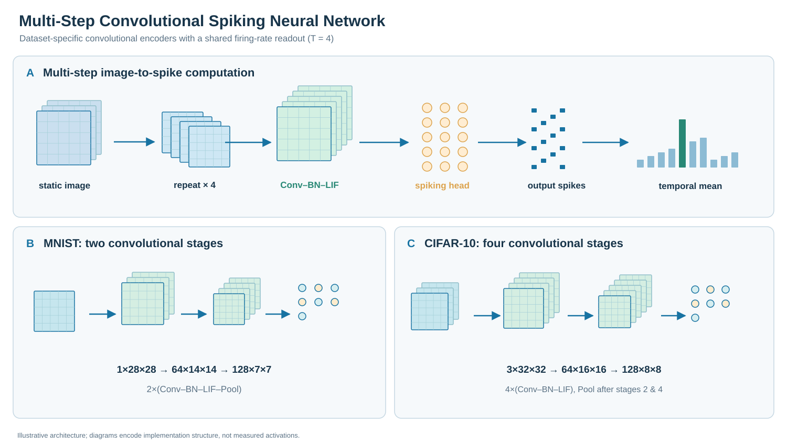
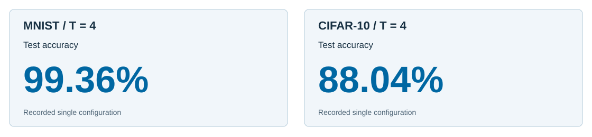
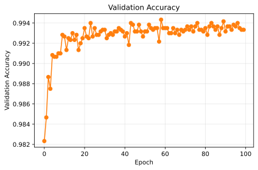
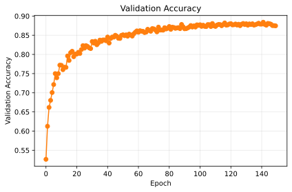
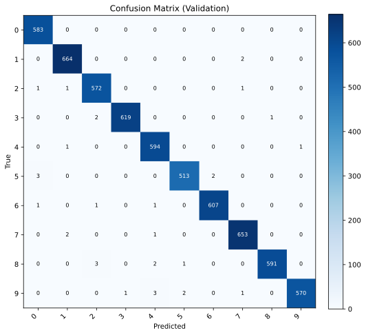
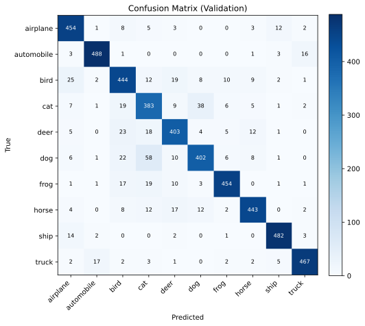

# Conv-SNN Baselines: Multi-Step Spiking Image Classification

**A compact, reproducible Conv–BN–Spike baseline for static-image recognition.**

PyTorch and [SpikingJelly](https://github.com/fangwei123456/spikingjelly) implementations of multi-step convolutional spiking neural networks (SNNs), with independent training, validation-based checkpoint selection, and held-out testing on **MNIST** and **CIFAR-10**.

## Abstract

Multi-step spiking neural networks offer an explicit temporal state representation for image classification while retaining trainable spatial feature extraction. This repository establishes a consistent static-image evaluation pipeline using convolutional synapses, LIF/IF spiking neurons, surrogate-gradient optimization, and firing-rate readout. Each input image is repeated across four timesteps, allowing membrane states to integrate the spatial features before prediction. A representative four-timestep Conv-SNN reaches **99.36% MNIST** and **88.04% CIFAR-10 test accuracy**, with validation-selected checkpoints and independent test evaluation. Together with recorded experiment metadata, learning curves, and confusion matrices, the implementation provides an auditable conventional spiking baseline for subsequent neural-computation studies.

## Contributions

1. **A compact multi-step Conv-SNN reference.** Dataset-specific convolutional feature extractors and LIF/IF temporal dynamics are exposed in a single configurable model, with time-averaged output spike rates as class scores.
2. **An auditable evaluation protocol.** Deterministic train/validation splitting, validation-selected checkpointing, separate official-test inference, run-level configuration, and plotting scripts support controlled baseline reuse.
3. **Strong recorded reference operating points.** With T = 4, the repository documents **99.36% MNIST** and **88.04% CIFAR-10 test accuracy**, providing concrete static-image reference values for future matched comparisons.

## Methodology



*Figure 1. Static repetition over T = 4 timesteps feeds a dataset-specific convolutional encoder and a spiking classification head. The figure shows spatial resolution and channel progression for both tasks; final predictions use the temporal mean of output spikes.*

**Temporal input.** For a static image $x$, the model applies $x^{(t)} = x$ for $t=1,\dots,T$. The neuronal state evolves through integration, thresholding, and reset, implemented using SpikingJelly [LIFNode/IFNode](snn_minimal/models/conv_snn.py).

**Spatial and spiking computation.** The MNIST encoder uses **two** 3×3 convolutional stages with batch normalization, spiking neurons, and 2×2 pooling. CIFAR-10 uses **four** 3×3 convolutional stages with pooling after the second and fourth stage. Both use a dropout–linear–spike classification head.

**Learning and readout.** The output firing-rate vector is

$$\hat{y}(x)=\frac{1}{T}\sum_{t=1}^{T}s_{\mathrm{out}}^{(t)}(x),\qquad \hat{c}=\arg\max_c\hat{y}_c(x).$$

[Training](snn_minimal/engine.py) minimizes mean-squared error between this output and the one-hot label using backpropagation through time and an ATan surrogate gradient. Spiking states are reset after each input batch.

## Experiments

**Primary finding — four-timestep static-image baselines achieve 99.36% MNIST and 88.04% CIFAR-10 test accuracy.**



*Figure 2. Selected completed four-timestep runs from [tracked experiment metadata](results/experiment_summary.json). Both values use the held-out official test split.*

| Dataset | Configuration | T | Training epochs | Best validation accuracy ↑ | Test accuracy ↑ |
|:--|:--|--:|--:|--:|--:|
| **MNIST** | 64 channels / hidden 256 / LIF | 4 | 100 | 99.43% | **99.36%** |
| **CIFAR-10** | 64 channels / hidden 256 / LIF | 4 | 150 | 88.40% | **88.04%** |
| CIFAR-10 | 64 channels / hidden 256 / LIF | 4 | 100 | 87.76% | 86.92% |

*Table 1. Single-run observations drawn from [results/experiment_summary.json](results/experiment_summary.json). Test accuracy is measured after per-run checkpoint selection by validation accuracy. The 100- and 150-epoch CIFAR-10 rows represent different recorded training runs.*

**Training behavior.** The checked-in plots document convergence and class-wise predictions for both tasks:

| MNIST | CIFAR-10 |
|:--:|:--:|
|  |  |
| *Validation accuracy across epochs* | *Validation accuracy across epochs* |
|  |  |
| *Recorded confusion matrix* | *Recorded confusion matrix* |

**Evaluation protocol.** A seeded 90/10 split of the official training data is used for learning and validation (default `val_ratio=0.1` and `split_seed=42`). Within each run, the checkpoint is selected using validation accuracy. `test.py` loads that checkpoint and computes performance on the official test set. Experiments above use **T = 4**, 64 base channels, hidden width 256, LIF neurons and recorded individual runs, rather than multi-seed estimates. The plotted confusion matrices are generated by the repository's plotting workflow; inspect their own underlying records before treating them as test-set artifacts.

## Reproduce

```bash
python3 -m venv .venv
source .venv/bin/activate
pip install -r requirements.txt

# MNIST research configuration
python train.py --dataset mnist --data-root ./data \
  --output-dir ./runs/mnist --epochs 100 --batch-size 64 \
  --timesteps 4 --channels 64 --hidden-dim 256 --device cuda --amp

# CIFAR-10 research configuration
python train.py --dataset cifar10 --data-root ./data \
  --output-dir ./runs/cifar10 --epochs 150 --batch-size 64 \
  --timesteps 4 --channels 64 --hidden-dim 256 --device cuda --amp

# Evaluate the best-validation checkpoint in a newly generated run
python test.py --run-dir ./runs/cifar10/RUN_NAME --device cuda
```

A short CPU smoke test can be run by changing `--epochs 100` to `--epochs 1` and `--device cuda` to `--device cpu`. The historical run folders and weights are stored separately; newly trained results depend on the environment and seed.

## Repository map

| Path | Role |
|:--|:--|
| [snn_minimal/models/conv_snn.py](snn_minimal/models/conv_snn.py) | Dataset-specific convolutional spiking models |
| [snn_minimal/engine.py](snn_minimal/engine.py) | MSE training, accuracy, state reset, checkpointing |
| [train.py](train.py) / [test.py](test.py) | End-to-end training and official-test evaluation |
| [results/experiment_summary.json](results/experiment_summary.json) | Tracked historical experiment outcomes |
| [assets/figures/](assets/figures/) | Learning curves and confusion matrices |
| [README.technical.md](README.technical.md) | Detailed implementation and command reference |
| [REFERENCE_NOTES.md](REFERENCE_NOTES.md) | Upstream dependency and implementation attribution |

## Takeaway

**A four-timestep convolutional spiking model provides reliable static-image reference results under a documented, validation-selected evaluation pipeline: 99.36% MNIST and 88.04% CIFAR-10.**

The conventional synapses and neuron blocks follow established SpikingJelly patterns. For learned Boolean synapses with temporal state, see the related [Logic-SNN](https://github.com/13710833172/Logic-SNN) project.

## License

[MIT](LICENSE). Dependencies retain their respective licenses.
