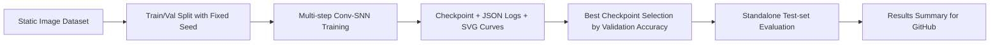

# Conv-SNN Research Baseline

A compact, reproducible spiking neural network project for **MNIST** and **CIFAR-10**. The goal is not to build a new framework; the goal is to package a small but credible research artifact that shows experimental discipline, clean implementation, and honest use of upstream tooling.

## Research Positioning

This repository is designed to show four things clearly:

- I can turn an idea into a runnable experiment instead of leaving it as a notebook fragment.
- I separate **training**, **validation**, and **test** correctly, with deterministic data splits.
- I keep dependency boundaries explicit: spiking operators come from SpikingJelly, while the experiment pipeline, evaluation protocol, and repository engineering are implemented here.
- I package results so another researcher can inspect the setup, reproduce the workflow, and extend it.

## What The Project Studies

The current question is simple and intentional:

> How far can a lightweight multi-step convolutional SNN go on static-image classification when the codebase is kept small, reproducible, and easy to audit?

The implementation uses:

- multi-step rate-based inference with `T` repeated timesteps
- `LIFNode` or `IFNode` neurons from SpikingJelly
- surrogate gradient training with `ATan`
- explicit checkpointing, metric logging, SVG curves, and standalone test-set evaluation

## Current Results

The summary below is generated from the tracked experiment metadata in [`results/experiment_summary.md`](results/experiment_summary.md).

| Dataset | Best Run | Epochs | Timesteps | Best Val Acc | Test Acc |
| --- | --- | ---: | ---: | ---: | ---: |
| MNIST | `mnist_20260602_052040` | 100 | 4 | **99.43%** | **99.36%** |
| CIFAR-10 | `cifar10_20260602_072653` | 150 | 4 | **88.40%** | **88.04%** |

## Experimental Design



Key controls:

- fixed random seed for training
- deterministic train/validation split through `--split-seed`
- no test-set leakage during training
- timestamped run directories with saved CLI arguments
- separate `test.py` for final evaluation

## Repository Highlights

| Path | Why it matters |
| --- | --- |
| `train.py` | Training entry point with checkpointing, scheduler, AMP, and validation loop |
| `test.py` | Rebuilds the model from a run directory and evaluates on the official test split |
| `snn_minimal/` | Minimal code surface for data loading, training engine, plotting, and model definition |
| `scripts/summarize_runs.py` | Converts raw run artifacts into a GitHub-friendly experiment summary |
| `.github/workflows/smoke-test.yml` | CI smoke test proving the project is not documentation-only |
| `REFERENCE_NOTES.md` | Explicit upstream attribution and scope boundary |

## Quick Start

```bash
python3 -m venv .venv
source .venv/bin/activate
pip install --upgrade pip
pip install -r requirements.txt
```

Train a small run:

```bash
python train.py \
  --dataset mnist \
  --data-root ./data \
  --output-dir ./runs/mnist \
  --epochs 5 \
  --batch-size 64 \
  --timesteps 4 \
  --device cpu
```

Evaluate the best checkpoint from a run directory:

```bash
python test.py \
  --run-dir ./runs/mnist/<timestamped-run> \
  --device cpu
```

## Reproduce The Strongest Runs In This Repo

MNIST:

```bash
python train.py \
  --dataset mnist \
  --data-root ./data \
  --output-dir ./runs/mnist \
  --epochs 100 \
  --batch-size 64 \
  --timesteps 4 \
  --channels 64 \
  --hidden-dim 256 \
  --device cuda \
  --amp
```

CIFAR-10:

```bash
python train.py \
  --dataset cifar10 \
  --data-root ./data \
  --output-dir ./runs/cifar10 \
  --epochs 150 \
  --batch-size 64 \
  --timesteps 4 \
  --channels 64 \
  --hidden-dim 256 \
  --device cuda \
  --amp
```

Refresh the tracked GitHub summary after new experiments:

```bash
python3 scripts/summarize_runs.py
```

## Reproducibility Checklist

- `args.json` stores the exact CLI configuration for each run.
- `metrics.json` stores final and best-validation checkpoints.
- `test_metrics.json` is written only by `test.py`.
- `train.log` records per-epoch metrics for later inspection.
- `train_loss.svg`, `val_acc.svg`, and `confusion_matrix.svg` are generated automatically after training.
- GitHub Actions runs a CPU smoke test to catch broken training/evaluation flows.

## Scope And Honesty

This is a **baseline research package**, not a claim of state-of-the-art performance. Its value is in:

- clear experiment boundaries
- credible implementation hygiene
- transparent attribution to upstream libraries
- a foundation for future ablations and stronger studies

## Next Research Directions

The most natural extensions from here are:

1. Compare `LIF` vs `IF`, and sweep `tau` and timestep count `T`.
2. Add matched-parameter ANN baselines to measure what the SNN inductive bias is actually buying.
3. Track sparsity or spike-rate statistics as a proxy for efficiency, not just accuracy.
4. Move from static-image repetition to event-based or neuromorphic datasets for a stronger temporal justification.
5. Add ablation tables and multiple random seeds to report mean and variance instead of single-run numbers.

## Additional Notes

- Detailed run summaries: [`results/experiment_summary.md`](results/experiment_summary.md)
- Chinese stage report: [`report.md`](report.md)
- Upstream attribution and design boundary: [`REFERENCE_NOTES.md`](REFERENCE_NOTES.md)
- Chinese experiment note: [`SNN实验说明.pdf`](SNN实验说明.pdf)

## Dependency

This project uses [SpikingJelly](https://github.com/fangwei123456/spikingjelly) commit `b049197b9589211418940c50031d3b7acb603bd6` through `requirements.txt`.
